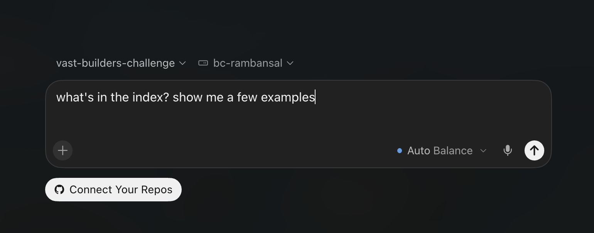

# VAST Builders Corner: Video Agents

Build with video:

<p align="center"></p>

The infrastructure is already running, so you skip straight to the interesting part: turning hours of video into something that searches, reasons, and acts.

## 1. Access VAST AI OS

1. Go to [workshop.thecosmoslabs.com](https://workshop.thecosmoslabs.com).
2. Enter the email address you were given.
3. Click **Open Desktop** to open your lab VM:

<p align="center"></p>

### Using Cursor

Cursor is your coding agent. Describe what you want in plain language and let it work, like this:

<p align="center"></p>

## 2. Video Search & Summary UI (Demo App)
> 💡 This example app runs on the same API as the skills (`.cursor/skills`) you will be using. It's a built idea of what you can build, and a quick way to explore the footage.

From the same workshop home page, click on Video Search & Summary:

<p align="center"></p>

Try a few of the search suggestions to see ranked clips with timestamps and the description Cosmos Reason returned for each one:

<p align="center"></p>

<!-- > [TODO] replace w/ giphy / video and search topic -->

Explore the three tabs:
**Search** to query videos, **Explore** to browse what's indexed, and **Dashboard** to get stats.

## 3. Quickstart

Run a few prompts in Cursor to see the stack work. Type each one into the agent panel.

### Search what's there

```
what's in the index? show me a few examples
```

You get back ranked segments with timestamps, scores, and the description the model wrote. Play one to confirm it's the moment you meant.

### Ask instead of search

```
what happens in the first video you showed me? summarize it in three sentences
```

Same index, different kind of answer. The first hands you moments. The second reads those moments and writes you an answer.

### Try a use case

We've ingested video for two use cases. Try one of these tracks:

**Formula racing (F1 Academy / Formula E):**

```
find the safety car on track and list the race, time and clip for each
```

**Football archive (Bundesliga):**

```
find goalkeeper saves across the matches and group them by season
```

Want to continue on a specific track? Ask Cursor to walk you through the prompts in [`prompts/`](prompts/):

```
show me the build tracks in prompts/ and let me pick one to run
```

> 💡 If a search comes back empty or something fails, see [If something looks off](#if-something-looks-off).

## 4. Summary

### What just happened
You searched and asked questions over hours of video in plain language. Behind each prompt, Cursor picked a skill, called the pipeline, and returned moments or an answer. You didn't set up any of it. Here's what ran behind them:

<p align="center"></p>

Everything under "pre-built, already running" was done for you.

### What you just used
- A **video pipeline**, orchestrated on VAST AI OS, that had already ingested, understood, and indexed the footage. Cosmos Reason, Cosmos Embed, and YOLO ran on CoreWeave GPUs; your prompts queried the results, not the models directly.
- **Cursor on your lab VM**, where this repo and your credentials and endpoints were already in place as environment variables.
- **Skills** that turned your plain-language prompts into calls to the pipeline.
- **Serverless LLM inference** from Weights & Biases by Coreweave, available for your own app's logic when you build further.

### If something looks off
Run the health check in the [Reference](BUILD_DAY.md#reference) section of the Build Day guide. If it fails, or you need more help, run `/ask-cosmos`. It writes up a note for you: copy it and share it with an organizer, and we'll debug it together.

## 5. Keep going

Want to keep going? See the [Build Day guide](BUILD_DAY.md).
